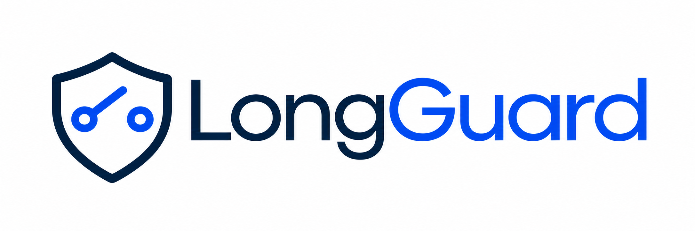
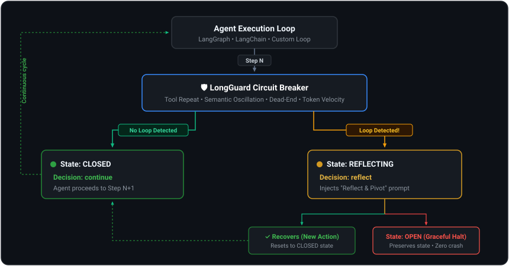

<div align="center">

<p align="center">
  
</p>

**In-flight circuit breaker & reasoning loop recovery for LangGraph & LangChain agents**

[](https://pypi.org/project/longguard/)
[](https://pypi.org/project/longguard/)
[](https://pypi.org/project/longguard/)
[](https://github.com/ENDEVSOLS/LongGuard/actions/workflows/ci.yml)
[](https://endevsols.github.io/LongGuard/)
[](https://opensource.org/licenses/MIT)
[](https://github.com/langchain-ai/langgraph)
[](https://github.com/langchain-ai/langchain)
[](https://github.com/crewAIInc/crewAI)
[](https://github.com/openai/openai-python)
[](https://github.com/anthropic/anthropic-sdk-python)

<p align="center">
  <a href="https://endevsols.github.io/LongGuard/getting-started/"><strong>⚡ Quick Start</strong></a> &nbsp;·&nbsp;
  <a href="https://endevsols.github.io/LongGuard/"><strong>📖 Documentation</strong></a> &nbsp;·&nbsp;
  <a href="https://endevsols.github.io/LongGuard/guides/configuration/"><strong>⚙️ API Reference</strong></a> &nbsp;·&nbsp;
  <a href="https://endevsols.github.io/LongGuard/concepts/detectors/"><strong>🔍 Loop Detection</strong></a> &nbsp;·&nbsp;
  <a href="https://endevsols.github.io/LongGuard/changelog/"><strong>📜 Changelog</strong></a>
</p>

</div>

---

<a id="overview"></a>
## Overview

> *"Why did my agent just burn $14 repeating the exact same search 20 times?"* — now you have an in-flight circuit breaker that detects loops and recovers gracefully.

When autonomous LLM agents hit an unexpected hurdle, they often get trapped in repetitive reasoning loops: calling identical tools with the same parameters, oscillating between two conflicting thoughts, or drifting aimlessly while burning thousands of tokens.

LangGraph's built-in `recursion_limit` is a **hard crash** (`GraphRecursionError`). It drops state, discards user context, and provides zero opportunity for recovery.

**LongGuard is an intelligent circuit breaker middleware.** It monitors your agent's chain-of-thought in real time, catches loops early, injects a **"Reflect & Pivot"** prompt to guide the agent back on track, and only halts (`kill`) gracefully if recovery fails—preserving complete state and token analytics.

---

<a id="part-of-the-long-suite"></a>
## 🌐 Part of the Long Suite

LongGuard is part of the **[EnDevSols Long Suite](https://endevsols.com/open-source)** of open-source production AI tools:

- **[LongParser](https://github.com/ENDEVSOLS/LongParser)** — High-speed, privacy-first local document ingestion & chunking (PDF, DOCX, PPTX, XLSX)
- **[LongTrainer](https://github.com/ENDEVSOLS/Long-Trainer)** — Production multi-tenant RAG chatbot and agent framework
- **[LongCache](https://github.com/ENDEVSOLS/LongCache)** — Production semantic similarity caching for LLM and RAG pipelines
- **[LongTracer](https://github.com/ENDEVSOLS/LongTracer)** — Post-generation hallucination detection via hybrid STS + NLI claim verification
- **[LongProbe](https://github.com/ENDEVSOLS/LongProbe)** — Sub-second RAG retrieval regression testing with pytest
- **[LongGuard](https://github.com/ENDEVSOLS/LongGuard)** — **In-flight runtime agent circuit breaker & reasoning loop recovery** ← *You are here*

Together, the Long Suite covers the full AI lifecycle from data ingestion and retrieval CI regression to runtime agent safety and post-generation verification.

---

<a id="why-longguard"></a>
## 💡 Why LongGuard?

- ⚡ **Sub-millisecond overhead**: Evaluates in-flight agent steps without slowing down LLM inference.
- 🔄 **4 loop detectors**: Catches tool repetition, semantic oscillation, dead-end drift, and token velocity spikes.
- 🧭 **Reflect & Pivot prompt injection**: Guides stuck agents back on track before giving up.
- 🛡️ **Zero unhandled crashes**: Gracefully terminates and preserves conversation state if recovery fails.
- 🔌 **1-line framework integrations**: Drop-in wrapper for LangGraph 1.0+ (`add_guard_to_graph`), LangChain (`GuardedAgentExecutor`), and CrewAI (`add_guard_to_crew`).
- 🔁 **Safe LangGraph resume**: Explicitly continue an eligible stopped graph run via `compile_guarded_graph` & `GuardedGraph.resume` without replaying completed tool calls.
- 🧹 **Tool-call history cleanup**: Original-ID cleanup for LangChain, OpenAI, and Anthropic histories keeps the conversation protocol-consistent after a trip.
- 🪄 **Universal `@guarded` decorator**: 1-line protection for arbitrary Python functions, generators, and async loops.
- 🐍 **Raw client support**: Use LongGuard directly with `openai` or `anthropic` SDK — no framework needed.
- 💵 **Dollar cost tracking**: Built-in model pricing; use `list_supported_models()` to see the current registry. Set `max_cost_usd` to hard-kill on budget overrun.
- 📊 **Full observability**: Detailed `GuardReport` with per-step telemetry. Save to JSON/YAML. Load for offline analysis.

---

<a id="architecture"></a>
## 🏗️ Architecture

<p align="center">
  
</p>

---

<a id="quick-start"></a>
## ⚡ Quick Start

### Installation

```bash
# Core package (standalone, zero heavy dependencies)
pip install longguard

# With LangGraph integration (LangGraph 1.0+)
pip install longguard[langgraph]

# With LangChain integration
pip install longguard[langchain]

# With CrewAI integration
pip install longguard[crewai]

# With high-quality sentence embeddings
pip install longguard[embeddings]

# Everything
pip install longguard[all]
```

> **Python 3.11+ required** as of v0.2.0.

### 1. LangGraph Integration (1 Line)

Compatible with **LangGraph 1.0+** and modern multimodal models (Claude 3.7, Gemini 2.5, GPT-4o):

```python
from langgraph.graph import StateGraph
from longguard.integrations.langgraph import add_guard_to_graph
from longguard import GuardConfig

# 1. Build your LangGraph workflow as usual
workflow = StateGraph(AgentState)
workflow.add_node("agent", agent_node)
workflow.add_node("tools", tool_node)
workflow.add_edge("agent", "tools")
workflow.add_conditional_edges("tools", should_continue)

# 2. Add LongGuard in one line!
workflow = add_guard_to_graph(workflow, GuardConfig())
app = workflow.compile()

# 3. Read execution telemetry after run
guard = workflow.__longguard__
print(guard.get_report().summary())
```

### 2. Safe LangGraph Resume (`compile_guarded_graph` + `GuardedGraph.resume`)

Continue an eligible stopped run without replaying completed tool calls. State, tool-call IDs, and token accounting are all preserved:

```python
from langgraph.checkpoint.memory import MemorySaver
from longguard import GuardConfig
from longguard.integrations.langgraph import compile_guarded_graph

checkpointer = MemorySaver()

# compile_guarded_graph wraps your workflow and injects interrupts at node boundaries
guarded_graph = compile_guarded_graph(workflow, GuardConfig(), checkpointer=checkpointer)

# First invocation
result = guarded_graph.invoke({"messages": [...]}, config={"configurable": {"thread_id": "t1"}})

# Explicit, controlled resume — only valid after an eligible stopped checkpoint
result = guarded_graph.resume("t1")

# Each run gets an independent report
print(guarded_graph.report("t1").summary())
```

### 3. CrewAI Integration (1 Line)

Protect multi-agent crews from delegation loops and repetitive tool calls:

```python
from crewai import Crew
from longguard import GuardConfig
from longguard.integrations.crewai import add_guard_to_crew

crew = Crew(agents=[researcher, writer], tasks=[task1, task2])
crew = add_guard_to_crew(crew, GuardConfig(model="gpt-4o", max_cost_usd=1.00))
result = crew.kickoff()

print(crew.__longguard__.summary())
```

> **Note:** CrewAI support is explicitly bounded to the tested sequential ReAct executor. Unsupported execution modes fail clearly; callback-only `CrewGuard` remains available for other topologies.

### 4. Universal `@guarded` Decorator

Add circuit breaking to any custom agent function or LLM call:

```python
from longguard import guarded

@guarded(max_cost_usd=0.50, tool_repeat_threshold=3)
def run_agent_step(thought: str, action: str, action_input: dict, observation: str):
    return execute_tool(action, action_input)

# Check execution report at any time:
print(run_agent_step.report.summary())
```

### 5. Raw OpenAI / Anthropic Client (No Framework Needed)

Call LongGuard directly from any `while` loop — works with plain `openai` or `anthropic` SDK:

```python
import openai
from longguard import AgentStep, CircuitBreaker, GuardConfig

client = openai.OpenAI()
breaker = CircuitBreaker(GuardConfig(
    model="gpt-4o",        # enables dollar-cost tracking
    max_cost_usd=0.50,     # hard-kill if run exceeds $0.50
    max_steps=30,
))

observation = None
for i in range(1, 31):
    response = client.chat.completions.create(model="gpt-4o", messages=messages)

    # One-line conversion from SDK response → AgentStep
    step = AgentStep.from_openai_response(response, step_number=i, observation=observation)
    decision = breaker.check(step)

    if decision.action == "kill":
        print(f"⛔ Halted: {decision.reason}")
        break
    elif decision.action == "reflect":
        messages.append({"role": "system", "content": decision.inject_prompt})

    if step.action is None:
        break  # final answer
    observation = run_tool(step.action, step.action_input)

# Full run report including estimated cost
print(breaker.report.summary())
# → Estimated Cost: $0.0143 USD (gpt-4o)
```

> For Anthropic: use `AgentStep.from_anthropic_response(response, step_number=i)` — same API, zero dependencies.

### 6. Standalone / Custom Agent Loop

If you run a custom `while` loop or proprietary agent orchestrator:

```python
from longguard import CircuitBreaker, GuardConfig, AgentStep

breaker = CircuitBreaker(GuardConfig(
    tool_repeat_threshold=3,    # 3 identical tool calls = trigger
    max_tokens_per_run=50_000,  # Hard token cap
))

for step in run_agent():
    decision = breaker.check(AgentStep(
        step_number=step.index,
        thought=step.thought,
        action=step.tool_name,
        action_input=step.arguments,
        observation=step.tool_output,
        tokens_used=step.tokens,
    ))

    if decision.action == "reflect":
        # Inject the recovery advice into your agent's context
        messages.append({"role": "user", "content": decision.inject_prompt})
    elif decision.action == "kill":
        print(f"Halted safely: {decision.reason}")
        break

# View summary report
print(breaker.report.summary())
```

---

<a id="loop-detectors"></a>
<a id="the-4-loop-detectors"></a>
## 🔍 The 4 Loop Detectors

| Detector | What It Catches | Real-World Example |
|---|---|---|
| **🔄 Tool Repeat** | Calling the same tool with identical inputs $\ge N$ times | Agent calls `search("revenue 2025")` 4 times with zero parameter changes |
| **🌀 Semantic Oscillation** | Cycling between the same concepts in reasoning | Agent reasons "Option A", then "No, B", then "Actually A", then "No, B" |
| **📉 Dead-End Drift** | Zero new information or observations for 5+ steps | Queries return empty results or repetitive error strings |
| **⚡ Token Velocity** | Sudden exponential token spikes per step | Agent injects giant raw HTML payloads into context, blowing budget |

---

<a id="comparison"></a>
## 📊 LongGuard vs. LangGraph `recursion_limit`

| Capability | LangGraph `recursion_limit` | LongGuard 🛡️ |
|---|:---:|:---:|
| **Detects Tool-Repeat Loops** | ❌ No | ✅ **Yes** |
| **Detects Semantic Reasoning Loops** | ❌ No | ✅ **Yes** |
| **Detects Sudden Cost / Token Spikes** | ❌ No | ✅ **Yes** |
| **Auto-Injects Recovery Prompts** | ❌ No | ✅ **Yes** |
| **Safe Graph Resume (no tool replay)** | ❌ No | ✅ **Yes** |
| **Exit Behavior** | 💥 Unhandled Exception (`Crash`) | 🛡️ **Graceful State Preservation** |
| **Run Reporting & Telemetry** | ❌ No | ✅ **JSON & Summary Reports** |
| **Configurable Thresholds** | ❌ Single integer | ✅ **Granular `GuardConfig`** |

---

<a id="configuration"></a>
## ⚙️ Configuration at a Glance

All behavior is customizable through `GuardConfig`:

```python
from longguard import GuardConfig

config = GuardConfig(
    # Loop Detection Sensitivity
    tool_repeat_threshold=3,          # Repeated tool calls before reflection
    tool_repeat_window=6,             # History window to examine
    dead_end_threshold=5,             # Steps with no progress before triggering
    token_velocity_multiplier=3.0,    # Spike multiplier vs rolling baseline

    # Hard Safety Guardrails
    max_tokens_per_run=50_000,        # Hard stop if agent burns > 50k tokens
    max_steps=30,                     # Maximum steps permitted
    max_reflections=2,                # Maximum recovery attempts before kill

    # Dollar Cost Tracking
    model="gpt-4o",                   # Enables built-in cost estimation
    max_cost_usd=0.50,                # Hard-kill if run exceeds $0.50
    # cost_per_input_token=2.5e-6,    # Override for unlisted models (USD/token)
    # cost_per_output_token=10e-6,
)
```

👉 *For detailed documentation on custom detectors, embedding backends, and LangSmith telemetry, see the [Full Documentation](https://endevsols.github.io/LongGuard/).*

## 🤝 Contributing

Contributions are welcome! Please see [CONTRIBUTING.md](https://github.com/ENDEVSOLS/LongGuard/blob/main/CONTRIBUTING.md) for guidelines on code formatting, running tests, and opening pull requests.

## 🛡️ Security

For vulnerability disclosures, please review [SECURITY.md](https://github.com/ENDEVSOLS/LongGuard/blob/main/SECURITY.md) or contact technology@endevsols.com.

## 📄 License

LongGuard is open-source software released under the [MIT License](https://github.com/ENDEVSOLS/LongGuard/blob/main/LICENSE).
